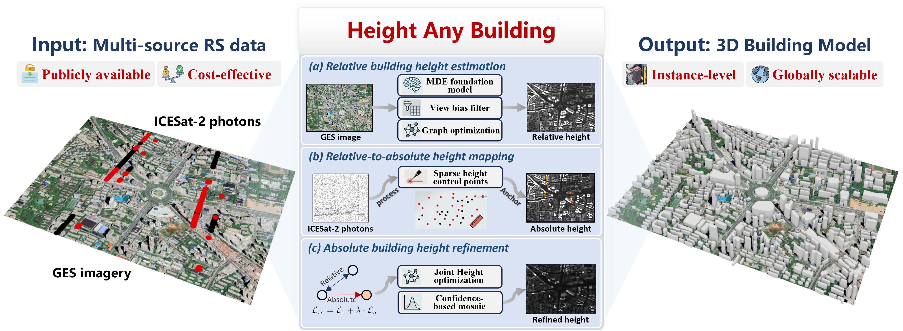

# Height Any Building: A Generalizable Method for Individual Building Height Estimation

<p align="center">Wuhan University</p>

**Published conference paper**

> **A training-free method for estimating the relative height of buildings**<br>
> [Zhe Chen](https://chenzhe-code.github.io/), [Chengjie Li](https://pipijie16.github.io/), [Fuxun Liang](https://liangfxwhu.github.io/), Peiling Tong, [Chen Long](https://chenlongwhu.github.io/), [Zhen Dong](https://dongzhenwhu.github.io/), and [Bisheng Yang](https://jszy.whu.edu.cn/yangbisheng/en/index.htm)<br>
> *ISPRS Archives*, 2025. [Paper](https://isprs-archives.copernicus.org/articles/XLVIII-1-W5-2025/7/2025/)

The HAB manuscript is under second-round review at *Remote Sensing of Environment* (RSE).

<p align="center">
  <a href="#requirements">Requirements</a> ·
  <a href="#quick-start">Quick start</a> ·
  <a href="#model-downloads">Model weights</a> ·
  <a href="#run-on-your-own-data">Run on your data</a>
</p>

## 🔭 Introduction

<p align="center">
  <a href="https://github.com/chenzhe-code/Height-Any-Building/blob/main/teaser.png">
    
  </a>
</p>

**Abstract**

Individual building heights help characterize urban 3D morphology and support climate and energy modeling as well as spatial planning. Detailed 3D building data are often available only for local areas. Broad-coverage height products typically lack the detail needed to distinguish individual buildings. We propose **Height Any Building (HAB)**, a method that combines single-view satellite imagery with ICESat-2 observations to estimate individual building heights at scale without region-specific training. HAB first estimates relative depth in overlapping image patches using a pretrained monocular depth foundation model in a zero-shot setting. A viewpoint bias filter converts relative depth into relative height, and graph optimization aligns the scales of neighboring patches. Sparse building-height controls derived from ICESat-2 photon measurements anchor the aligned estimates to a metric scale. HAB then jointly refines the relative and absolute heights, combines the patches through confidence-weighted mosaicking, and assigns heights to individual building footprints. Experiments in study areas worldwide show that HAB achieves state-of-the-art performance among the evaluated methods across a range of building forms, densities, and styles.

## 🆕 News

- **2026-11-27** · The Browser interface is available.
- **2026-11-27** · The source code is publicly available.
- **2025-11-04** · The conference paper on relative building height estimation was published in *ISPRS Archives*. [Paper](https://isprs-archives.copernicus.org/articles/XLVIII-1-W5-2025/7/2025/)

<a name="requirements"></a>

## 💻 Requirements

- Linux x86-64 with Conda
- NVIDIA GPU with CUDA for inference (tested on GeForce RTX 4090)

| Conda environment | Python | Used for |
| --- | --- | --- |
| `hab-core` | 3.10 | CPU demo, image preparation, ATL03, height calibration, and outputs |
| `distill-any-depth` | 3.10 | Distill-Any-Depth inference |
| `depth-anything-v1` | 3.10 | Depth Anything V1 inference |
| `depth-anything-v2` | 3.10 | Depth Anything V2 inference |
| `synrs3d` | 3.10 | SynRS3D as the primary model or as the seam model |
| `mlsbrn` | 3.8 | Automatic building footprint and roof-offset inference |

For real imagery, install `hab-core`, `mlsbrn`, and the environment for your chosen depth or height model. Add `synrs3d` when using cross-tile optimization. The command line and browser interface dispatch each stage to its own environment. [Installation and dependencies](environments/README.md)

<a name="quick-start"></a>

## 🚀 Quick start

Run these commands from the repository root.

```bash
conda env create -f environments/environment.yml
conda activate hab-core
python -m pip install -r environments/requirements.txt
python scripts/run_cpu_demo.py --work-dir work_dir/cpu-demo
```

The CPU demo checks calibration, overlap fusion, and height assignment on six synthetic buildings with known heights. It needs no GPU, model checkpoints, or Earthdata account. A successful run prints `CPU demo passed` and writes these files.

- **Building height raster** · `work_dir/cpu-demo/building_height_raster.tif`
- **Per-building heights** · `work_dir/cpu-demo/per_building_heights.geojson`

<a name="model-downloads"></a>

## 📦 Model downloads

Download the MLS-BRN checkpoint and the depth or height model you plan to use. Create the parent directories under the repository root and save each file at the path shown in the table. Cross-tile optimization also requires SynRS3D.

| Model | Checkpoint source | Save as |
| --- | --- | --- |
| Distill-Any-Depth Large | [Provider checkpoint](https://huggingface.co/xingyang1/Distill-Any-Depth/blob/main/large/model.safetensors) | `checkpoints/Distill-Any-Depth/Dav2-large.safetensors` |
| Depth Anything V1 Large | [Provider checkpoint](https://huggingface.co/spaces/LiheYoung/Depth-Anything/blob/main/checkpoints/depth_anything_vitl14.pth) | `checkpoints/DEPTH-ANYTHING-V1/depth_anything_vitl14.pth` |
| Depth Anything V2 Large | [Provider checkpoint](https://huggingface.co/depth-anything/Depth-Anything-V2-Large/blob/main/depth_anything_v2_vitl.pth) | `checkpoints/DEPTH-ANYTHING-V2/depth_anything_v2_vitl.pth` |
| SynRS3D | [RS3DAda height checkpoint](https://huggingface.co/JTRNEO/RS3DAda/blob/main/RS3DAda_vitl_DPT_height.pth) | `checkpoints/SynRS3D/RS3DAda_vitl_DPT_height.pth` |
| MLS-BRN | [Project-trained MLS-BRN checkpoint (1.84 GB)](https://github.com/chenzhe-code/Height-Any-Building/releases/download/mls-brn-weights/mlsbrn-inference.pth) | `MLS-BRN/checkpoints/mlsbrn-inference.pth` |

Run these commands from the repository root once you have the MLS-BRN checkpoint.

```bash
mkdir -p MLS-BRN/checkpoints
mv /path/to/download/mlsbrn-inference.pth MLS-BRN/checkpoints/
```

See the legacy checkpoint locations and the checksum of the verified MLS-BRN export. [Checkpoint setup](environments/README.md#weights)

<a name="run-on-your-own-data"></a>

## 🗺️ Run on your own data

Use a three-band UInt8 RGB GeoTIFF with a CRS and image coverage throughout the target area. For one image, HAB prepares a 1 m projected grid and tiles large inputs automatically. It accepts `--target-crs` to set the projected metre CRS explicitly. For batch processing, provide prepared GeoTIFF tiles. Cross-tile optimization expects aligned 1 m tiles in the same projected CRS with shared edges.

Select local ATL03 if you already have the HDF5 granules. To download ATL03, use your own Earthdata account. For the CLI, provide credentials in your private `.netrc` or through `EARTHDATA_USERNAME` and `EARTHDATA_PASSWORD`. On the web interface, enter them when you first run an online task. [NASA Earthdata Login](https://urs.earthdata.nasa.gov/)

### Browser interface

```bash
python scripts/run_ui.py --data-root /path/to/imagery --data-root /path/to/atl03
```

Open `http://127.0.0.1:7860`. Choose single-image processing, batch processing, or the CPU self-check. The default primary model for real imagery is Distill-Any-Depth. Use the advanced settings to enable cross-tile optimization. The results tab supports panning and zooming the 2D map, switching to the interactive LOD1 preview, and downloading the original GeoTIFF and GeoJSON. The LOD1 preview requires WebGL.

#### Wuhan Guanggu walkthrough

This 1 min 33 sec video shows a single-image run with Distill-Any-Depth, MLS-BRN, and local ATL03 files. It covers the full workflow and ends with the 2D height raster and the interactive LoD1 model for 1,508 buildings. The processing stages are shown in time-lapse.

### Single image from the command line

```bash
conda activate hab-core
python tools/run_image.py \
  --image /path/to/image.tif \
  --work-dir work_dir/my-image \
  --model Distill-Any-Depth \
  --local-atl03-dir /path/to/atl03 \
  --gpus 0
```

If you omit `--model`, the CLI uses Distill-Any-Depth for one tile and SynRS3D for multiple tiles. SynRS3D uses cross-tile optimization automatically on a multi-tile image. Enable it for another primary model with `--global-mode patch` or disable it with `--global-mode none`. Append `--dry-run` to preview the tiling and commands or `--check` to verify the weights and GPU environments. To download ATL03, omit `--local-atl03-dir` and optionally set `--atl03-start-date` and `--atl03-end-date`.

### Batch of prepared tiles

```bash
bash scripts/run_batch_work_dir.sh \
  --input-dir /path/to/tiles \
  --output-root work_dir/my-area \
  --model Distill-Any-Depth \
  --local-atl03-dir /path/to/atl03 \
  --atl03-scope shared --gpus 0 --no-uncertainty --merge-city
```

Add `--global-patch-optimize` to refine the seams. The ordinary mosaic remains available alongside the optimized results, and regions that lack usable seam or photon evidence retain their independent heights. A repeat run with the same working directory can reuse completed stages. [Cache and resume behaviour](environments/README.md#reusing-a-work-directory)

### Outputs

| Run | Height raster | Per-building heights |
| --- | --- | --- |
| Single tile | `<depth-work-dir>/AbsoluteHeight/output.tif` | `footprint_direct_nms_absolute_height.geojson` |
| Mosaic of independently calibrated tiles | `city_absolute_height_1m_uint16.tif` | `city_building_heights.geojson` |
| Cross-tile optimization | `city_global_patch_height_1m_uint16.tif` | `city_global_patch_building_heights.geojson` |

City outputs appear under the batch output root, or under `<work-dir>/results/` if you started with one large image. The optimized GeoJSON uses the optimized raster. See `global_patch_diagnostics.json` for seam errors, held-out control errors, and any regions retained from the independent tiles.

## 🛠️ Advanced workflows

<details>
<summary>Run individual stages</summary>

Use a common `JOB_DIR`, input image, and window settings across the stages.

| Command | Stage |
| --- | --- |
| `bash scripts/split_image.sh` | Split the RGB GeoTIFF into windows |
| `bash scripts/building_extraction.sh` | Extract and georeference building footprints and roof offsets |
| `bash scripts/sparse_height_extraction.sh` | Build sparse control heights from ATL03 |
| `bash scripts/depth_estimation.sh` | Run the selected depth or height model |
| `bash scripts/PRD2WAH.sh` | Calibrate and fuse the prediction windows |
| `bash scripts/run_full_pipeline.sh --steps 10` | Assign heights to building footprints |

</details>

<details>
<summary>Use prepared predictions, controls, and footprints</summary>

Place georeferenced predictions in `<prediction-directory>/depth/` as `window_<id>_x<X>_y<Y>_depth.tif`. Use a control raster on the same grid and match the window size and overlap to your predictions. This workflow uses the core environment.

```bash
python tools/calibrate_heights.py \
  --work_dir /path/to/prediction-directory \
  --ch_img_path /path/to/sparse_control_height.tif \
  --window_size 1024 --overlap 0.5 --down_ratio 1 \
  --block_size=-1,-1 --fusion_mode mean

python tools/assign_building_heights.py \
  --geojson-path /path/to/footprints.geojson \
  --geotiff-path /path/to/prediction-directory/AbsoluteHeight/output.tif \
  --output-path /path/to/building_heights.geojson --apply-offset
```

For metric prediction windows, use `--metric_input --skip-ground-filter` in place of `--ch_img_path` and its argument. For footprints that already align with the roofs in the raster, use `--no-apply-offset --height-column Extracted_Height` for direct sampling.

Evaluate `Extracted_Height` against `LiDAR_Height` and save a scatter plot.

```bash
python tools/evaluate_building_heights.py --geojson /path/to/heights_with_reference.geojson
```

</details>

## 📚 Citation

```bibtex
@article{chen2025relativeheight,
  author  = {Chen, Zhe and Li, Chengjie and Liang, Fuxun and Tong, Peiling and
             Long, Chen and Dong, Zhen and Yang, Bisheng},
  title   = {A training-free method for estimating the relative height of buildings},
  journal = {The International Archives of the Photogrammetry, Remote Sensing and Spatial Information Sciences},
  year    = {2025},
  volume  = {XLVIII-1/W5-2025},
  pages   = {7--12},
  doi     = {10.5194/isprs-archives-XLVIII-1-W5-2025-7-2025}
}
```

## 🤝 Acknowledgements and licence

HAB builds on MLS-BRN, Distill-Any-Depth, Depth Anything, and SynRS3D, and uses NASA ICESat-2 ATL03 data. The third-party notices list the source projects and applicable terms. [Third-party notices](THIRD_PARTY_NOTICES.md)

The original HAB code is available for non-commercial scientific research. Commercial use and research by or on behalf of an enterprise require separate written permission. Third-party components and checkpoints retain their own terms. [Project licence](LICENSE)
